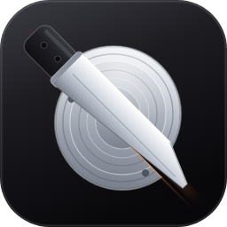
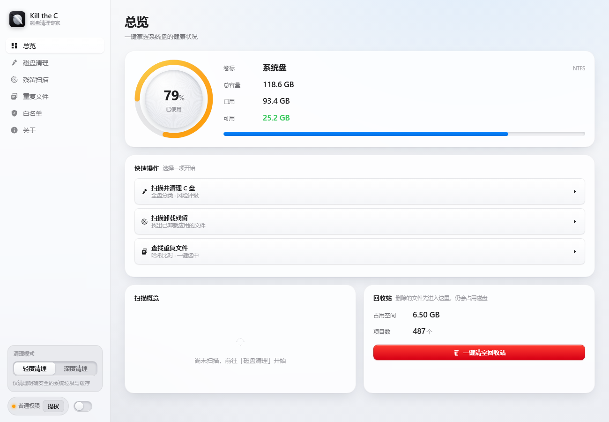
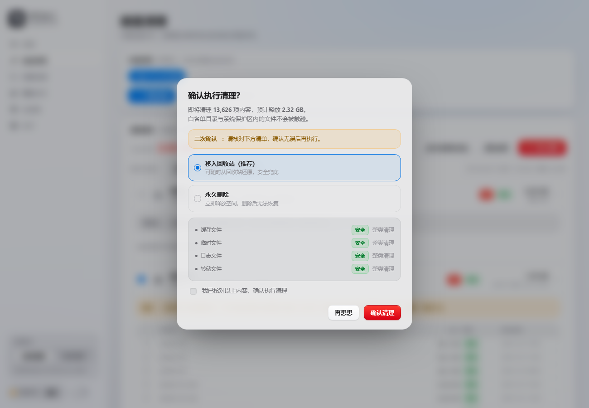
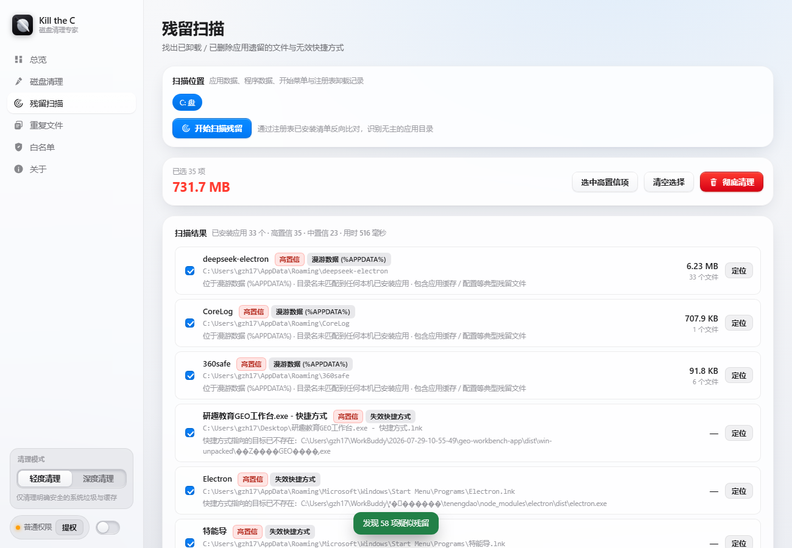
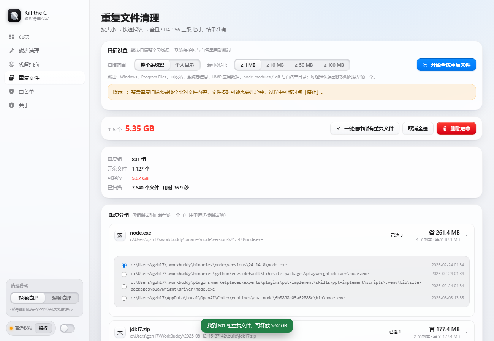
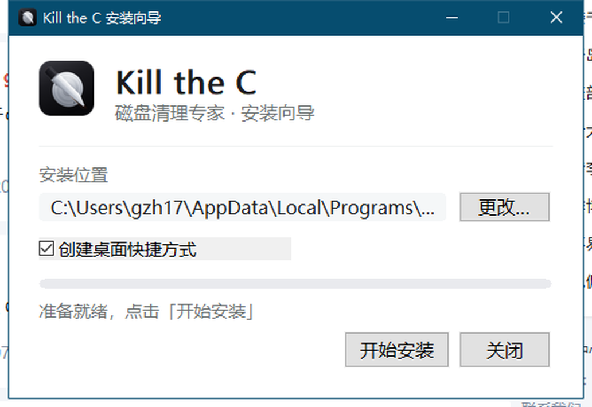
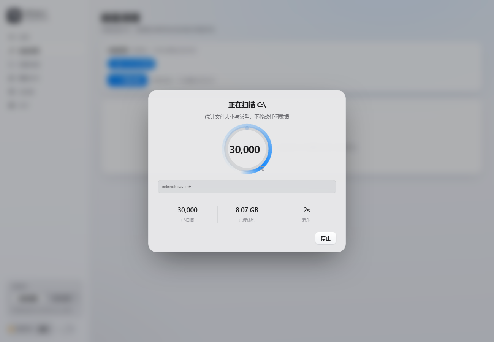
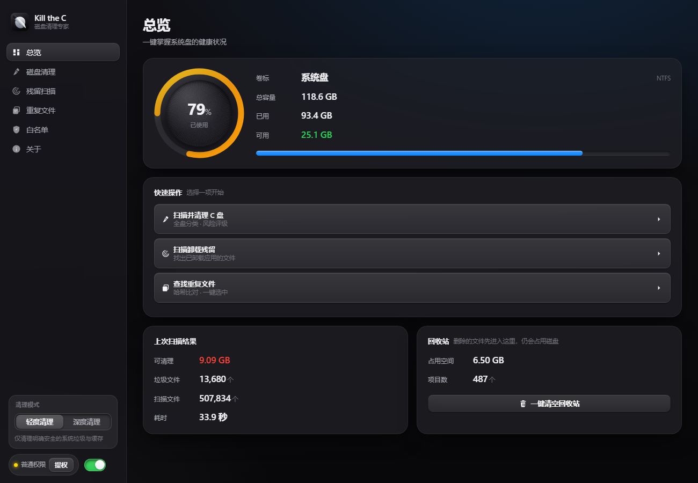

# Kill the C C盘清理

> 轻量级 Windows 系统盘清理工具 ｜ 苹果式简约科技风 ｜ **安装包 5.0 MB** ｜ MIT License

黑色系图标：一把刀把磁盘切成两半。



---

## 功能一览

| 功能 | 说明 |
| --- | --- |
| **C 盘清理** | 先扫描全盘文件，按 16 个类目分类，给出**优先级（P0–P3）与风险等级（安全/谨慎/高风险/受保护）**；支持按文件大小、数量、优先级排序；用户选择后再执行清理；清理过程中实时显示进度与**当前处理的文件名** |
| **白名单文件夹** | 加入白名单的文件夹默认不参与任何扫描与清理，删除前还会再校验一次 |
| **残留应用扫描** | 比对注册表已安装清单，找出已卸载 / 已删除应用留下的目录、注册表孤儿项与失效快捷方式，支持彻底清理 |
| **重复文件清理** | 默认扫描**整个系统盘**（可切「个人目录」），大小 → 快速指纹 → 全量 SHA-256 三级比对；**一键选中所有重复文件**；每组可自定义保留项 |
| **轻度 / 深度两种模式** | 轻度只清明确安全的垃圾；深度额外纳入更新缓存、备份、大文件（≥32 MB） |
| **二次确认兜底** | 每次清理都弹窗列出清单与体积；永久删除需手动输入确认词 |
| **一键清空回收站** | 每个清理功能完成后提供入口，清空前再次弹窗确认（需输入「清空」） |

> 额外补充的必要机制：全局白名单、系统保护区硬性不可勾选、单实例互斥、
> 管理员提权、深浅色主题、任务可随时中止、执行前二次安全复核。

---

## 界面

| 总览 | 磁盘清理 |
| --- | --- |
|  |  |

| 二次确认 | 残留扫描 |
| --- | --- |
|  |  |

| 重复文件 | 安装向导 |
| --- | --- |
|  |  |

| 类目明细 | 扫描进度 |
| --- | --- |
|  |  |

深色主题：



---

## 下载安装

从 [**Releases**](../../releases) 下载 `KillTheC-Setup.exe`（约 5 MB），双击安装即可，**无需管理员权限**。

安装后从开始菜单或桌面启动。卸载走「设置 → 应用」，或直接运行：

```bash
KillTheC-Setup.exe /S [/D=<目录>]              # 静默安装
"<安装目录>\KillTheC.exe" --uninstall --silent  # 静默卸载
```

> Windows 10 1803+ / Windows 11 自带 WebView2 运行时；若缺失会自动回退到 Edge 窗口打开。

---

## 目录结构

```
├── build.sh                  一键构建（首次自动获取 Go 工具链）
├── LICENSE                   MIT 许可证
├── docs/
│   ├── GitHub上传指南.md      发布到 GitHub 的完整步骤
│   ├── 技术文档.md            架构、技术选型、核心机制、实测记录
│   ├── 使用说明.md            逐功能操作指引与常见问题
│   └── images/               界面截图
├── assets/                   图标（svg / png / ico）
├── src/                      主程序源码（Go + 内嵌前端）
├── installer/                安装程序源码（Win32 原生安装器）
├── tools/                    图标生成与快捷方式诊断脚本
└── dist/                     构建产物（不入库，见 Releases）
```

---

## 从源码构建

**前置依赖**：Windows 10/11 x64、Git Bash、Python 3（标准库即可）、可访问网络。
Go 工具链无需预装——`build.sh` 会自动获取到 `.tools/go`。

```bash
bash build.sh
```

首次运行会把 Go 工具链下载到 `.tools/go`（约 10 秒，走 goproxy.cn），
随后自动完成资源生成、编译、压缩、打包，并校验安装包是否 ≤ 20 MB。

输出：`dist/KillTheC-Setup.exe`

> 仓库已包含生成好的 `assets/KillTheC.ico`，因此**常规构建不需要浏览器**。
> 只有修改了 `assets/icon.svg` 需要重新出图时，才会调用 `tools/makeicon.py`，
> 届时需要一个 Chromium 内核浏览器（Chrome / Edge；也可用 `KTC_CHROME` 指定路径）。

---

## 体积

| 项目 | 体积 |
| --- | --- |
| 主程序 KillTheC.exe | 7.17 MB |
| 负载（gzip -9） | 3.00 MB |
| **安装包 KillTheC-Setup.exe** | **5.02 MB**（约束 20 MB） |

技术栈为 Go 1.25（纯 syscall，无 cgo）+ WebView2（系统已预装，不下发运行时），
因此没有 Electron / .NET / Python 那种几十 MB 的运行时开销。详见[技术文档](docs/技术文档.md)。

---

## 安全原则

**本工具不会在你没点确认的情况下删除任何东西。**

扫描阶段只读；所有删除都有二次确认弹窗；默认删除方式是移入回收站；
永久删除需手动输入确认词；系统保护区（`System32`、`WinSxS` 等）与盘符根目录硬性禁止清理；
白名单在扫描与删除两个环节都会校验。

---

## 许可证

本项目基于 [MIT License](LICENSE) 开源，Copyright (c) 2026 Wu Bage。

你可以自由使用、修改、分发，包括商业用途，只需保留原始版权声明。

---

## 免责声明

本工具会删除文件。请在使用前确认清理清单，并优先保留默认的「移入回收站」方式。
作者不对因数据误删造成的损失承担责任。
